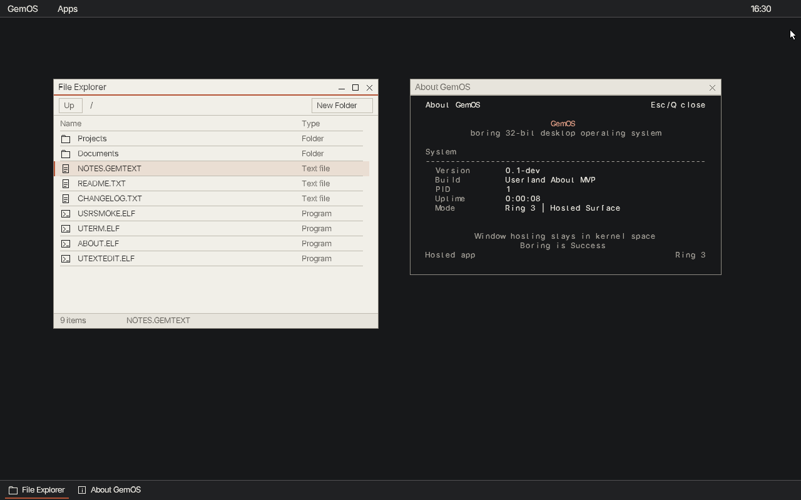

<div align="center">
  <h1>GemOS</h1>
  <p><strong>A 32-bit x86 desktop operating system written in C and assembly</strong></p>
  <p>
    <a href="https://github.com/Maksu2/GemOS/releases"></a>
    <a href="https://github.com/Maksu2/GemOS/actions/workflows/ci.yml"></a>
    <a href="LICENSE"></a>
  </p>
  
  <p><a href="#download-and-run">Download and run</a> · <a href="#current-userland">Apps</a> · <a href="#build-run-and-debug">Build from source</a> · <a href="https://github.com/Maksu2/GemOS/wiki">Wiki</a></p>
</div>

GemOS has its own bootloader, kernel, GemFS storage and desktop shell. The Terminal, About and text editor run in isolated user processes. The graphite desktop uses flat windows and a rust accent to mark focus and selection.

## Download and run

Pick your platform and extract its ZIP. Each package contains one launcher with both disk images embedded. [GitHub Releases](https://github.com/Maksu2/GemOS/releases)

| Host | Download | Start |
| --- | --- | --- |
| Apple Silicon Mac | `GemOS-Apple-Silicon-*.zip` | Double-click `RunGemOS.command` |
| Windows x64 | `GemOS-Windows-x64-*.zip` | Double-click `RunGemOS.bat` |
| Linux | `GemOS-Linux-*.zip` | Run `./RunGemOS.sh` |

The Mac launcher installs QEMU through Homebrew when needed. The Windows launcher uses WinGet when available. Linux uses the distribution's QEMU with desktop display support. On Debian or Ubuntu install `qemu-system-x86` and `qemu-system-gui`.

Open **Apps → File Explorer** to start in `~`, your documents folder. Right-click empty space for **New Folder**, or a file or folder for **Rename**. Double-click a `.txt` file to open it in UTEXTEDIT. Click **Up** from `~` to reach older root files and the bundled `.ELF` programs. Use **GemOS → Shutdown** at the end of a session. The next launcher reuses your data disk from the same location.

| Host | Persistent data disk |
| --- | --- |
| macOS | `~/Library/Application Support/GemOS/data.img` |
| Windows | `%LOCALAPPDATA%\GemOS\data.img` |
| Linux | `~/.local/share/GemOS/data.img` or `$XDG_DATA_HOME/GemOS/data.img` |

### Bootable ISO

`GemOS-*.iso` boots as a CD-ROM in an x86 VM with a legacy BIOS. Allocate 128 MB of RAM and select CD boot. A separate IDE disk formatted as GemFS gives the desktop writable storage. `SHA256SUMS.txt` covers the three ZIPs and the ISO.

## What works now

### Boot and kernel foundations

- 2-stage bootloader from a floppy (CHS) or a hard disk (INT 13h extensions, LBA); the kernel size comes from a header in the image
- A20, E820 memory map, protected mode, kernel entry with a boot info block (boot drive, memory map, video mode)
- kernel-owned GDT for ring 0 / ring 3
- TSS, `ltr`, and `esp0` stack switching
- IDT, ISR / IRQ handling, PIC remap, PIT, RTC
- serial debug path

### Memory and execution

- heap and page frame pool sized from the E820 map (the kernel uses RAM below 32 MB; it stops with a message if there is too little)
- 32-bit legacy paging with 4 KB pages
- separate `CR3` per process
- shared supervisor-only kernel mapping as the transition model
- round-robin scheduler with an idle task and blocking waits; only ring 3 code is preempted, kernel code runs until it gives up the CPU
- syscalls run with interrupts on, and a long file read or write lets the GUI and other processes run between disk blocks while it keeps the file system to itself
- `process_t` / `task_t` split
- any exception raised in ring 3 kills and reaps only that process (NMI, double fault and machine check excepted); a kernel exception halts with a full register dump
- per-task x87/SSE state (FXSAVE/FXRSTOR on every task switch); interrupt handlers do not touch the FPU
- user code pages are read-only, also for the kernel (`CR0.WP`); data has its own segment
- a guard page under every kernel stack; a kernel stack overflow ends in the double fault handler (a separate hardware task) with a register dump
- heap blocks with magic values and a canary: double frees, overwritten headers and overruns are caught; small font allocations come from their own pool
- an ELF loader whose range checks cannot wrap around

### Desktop, drivers and storage

- VBE LFB graphics: the best mode from 1920x1080 down to 800x600 (32 bpp); the UI is drawn 2x on Full HD
- page flipping on the Bochs/QEMU adapter (BGA), memcpy to the framebuffer elsewhere; a mouse move that changes nothing else draws only the cursor, and a change in one window only that window's rectangle
- PS/2 keyboard and mouse
- TrueType font rendering
- window manager: new windows open between the topbar and the dock and cascade, dragging keeps the title bar reachable, text is clipped to its window
- graphite desktop with light windows, a rust-colored focus marker and a dock with window titles and icons
- Shutdown waits for the file system to finish writing. It turns the machine off with ACPI on QEMU and Bochs, or halts and says it is safe to turn it off
- File Explorer starts in `~` (`/Home`). Its system context menu offers **Open** and **Rename** where applicable, or **New Folder** on empty space. Enter opens the selected item and F2 renames it. Scroll with the scrollbar, arrow keys, Page Up, Page Down, Home or End
- ATA PIO with IDENTIFY, timeouts and error checks; without a data disk the system runs without a file system
- GemFS v3 on a whole disk: a superblock with a checksum, a block bitmap, inodes and directories, files up to about 4 MB. The kernel mounts only a disk with a valid superblock, never formats one and never writes to a disk it has not mounted; `tools/mkgemfs` makes and inspects disks on the host
- writes are ordered so that a crash keeps every file whole: at worst it leaves blocks and inodes that nothing uses, and the next mount frees them

### Userland transition

- Ring 3 (`CPL=3`)
- ELF32 static `ET_EXEC` loader
- `int 0x80` syscall layer
- safe copy helpers for user pointers
- hosted app model: kernel hosts the window/surface and draws every character in its own cell of the grid, userland owns app state and render logic
- hosted close requests and keyboard modifiers
- file read/write syscalls (`UTEXTEDIT.ELF` opens and saves files with them)

## Current architecture

GemOS is intentionally in a transition architecture:

- the desktop shell, WM, topbar, dock and window decorations remain in kernel space
- userland applications run as isolated processes with their own address spaces
- userland apps talk to the system through a small syscall surface and a hosted text-surface window model

That is deliberate. GemOS is not trying to jump straight from “all apps in kernel space” to “full userspace GUI toolkit” in one rewrite.

```text
boot/ stage1 + stage2
        ↓
kernel core: interrupts, paging, heap, scheduler, ELF, syscalls
        ↓
drivers and graphics: VBE, PS/2, ATA, serial, fonts
        ↓
desktop shell: WM, topbar, dock, menus, kernel-hosted windows
        ↓
hosted app services: console/window surface, input delivery, file I/O
        ↓
userland apps: UTERM.ELF, ABOUT.ELF, UTEXTEDIT.ELF
```

## Current userland

| App | State | What it proves |
| --- | --- | --- |
| `UTERM.ELF` | Usable | Real Ring 3 terminal with input, output and hosted-window lifecycle |
| `ABOUT.ELF` | Stable | Small polished userland app with timed updates and clean close flow |
| `UTEXTEDIT.ELF` | Usable | Hosted editor that opens and saves text files (up to 8 KB) on GemFS, starts its file prompts at `~/`, and asks before unsaved changes are lost |

### Rust applications

The [Rust SDK](userland/rust/gemos.rs) gives `no_std` programs a typed interface to the hosted console, keyboard and close events, and GemFS file I/O. Rust compiles the application to a static x86 ELF32 using `core`. GemOS supplies the startup code, syscall bindings, and panic handler. A panic is reported over serial and ends the application's process.

With the build tools below and a Rustup-managed compiler, run the demo in QEMU.

```bash
rustup toolchain install 1.100.1 --profile minimal --target i586-unknown-linux-gnu
make run-rust RUSTC='rustc +1.100.1'
```

Open **Apps → File Explorer**, go **Up**, and double-click `RUSTDEMO.ELF`. The demo reads a GemFS text file, displays it, and saves a copy on the demo disk. Press **Esc** or click **X** to close it. Press **P** to try a panic, then reopen the app. QEMU writes to a temporary overlay for this session.

`make test-rust RUSTC='rustc +1.100.1'` runs the same ELF on Pentium II, QEMU32, Intel Nehalem and AMD Opteron profiles. It checks console input, recovery after a panic and the saved file. GitHub Actions includes these results in **PR checks**.

## Build, run and debug

### Tooling

- `nasm`
- `qemu-system-i386`
- an `i686-elf-*` or `x86_64-elf-*` cross toolchain, or a host `gcc`/`binutils` that accepts `-m32` (the Makefile falls back to it automatically; CI uses this path)
- Python 3 for the smoke test

On macOS:

```bash
brew install nasm qemu i686-elf-gcc
```

On Debian/Ubuntu (host `gcc -m32` fallback):

```bash
sudo apt-get install nasm qemu-system-x86 gcc
```

Build, test and run:

```bash
make all          # build/gemos.img (floppy) and build/gemos-hdd.img
tools/smoke.sh    # build, boot headless in QEMU, start UTERM/ABOUT/UTEXTEDIT, shut down
tools/smoke.sh --editor   # UTEXTEDIT with files: save as, reopen from the File Explorer,
                          # the unsaved-changes question, a refused save over a program
tools/smoke.sh --explorer # context menus, Home, rename and double-click after reboot
tools/smoke.sh --stress   # 25 cycles of opening, typing into and closing them
tools/smoke.sh --matrix   # smoke test on 32/64/256 MB, no data disk, 4 MB VRAM, hard disk boot,
                          # disks without GemFS that must stay unchanged, a second boot,
                          # a slow disk, a machine without ACPI, a disk after a crash
tools/smoke.sh --selftest # kernel self-test image: heap, ELF loader, GemFS, FPU, every ring 3
                          # exception; boots twice on the same disks
make run          # QEMU window with the GemFS data disk (build/data.img)
tools/mkgemfs ls build/data.img /   # list, cat, put, mkdir, rm, check on the host
make run-hdd      # the same, booting from the hard disk image
```

`tools/smoke.sh` reports each check and saves serial logs and screenshots under `build/`. GitHub Actions runs smoke, the editor and Explorer tests, stress, the boot matrix and the kernel self-tests on pushes, pull requests and merge-queue checks. The Explorer suite covers 1920×1080 and a 1280×800 configuration with 32 MB RAM, 4 MB VRAM, a Pentium II CPU without FXSR and throttled disk writes. Each job uploads its logs and screenshots.

### Build the release packages

Install `genisoimage` to create the bootable CD image. Package the same floppy image you tested with QEMU.

```bash
make all
python3 tools/package_qemu.py --version dev
python3 tools/test_qemu_package.py
```

Actions packages the boot image from the smoke and editor job. The launchers run on macOS arm64, Windows x64 and Linux runners, with a second boot that checks the data disk. Linux also boots the packaged ISO and exercises Explorer. Green **PR checks** publishes the tested packages as a run artifact. Pushing a `v` tag also publishes the assets as a GitHub prerelease after the checks pass.

`make selftest` builds `build/selftest/gemos.img`, a kernel with `kernel/selftest.c`: it checks that heap corruption is detected, that broken ELF files are rejected, that every exception a ring 3 program can raise ends only that program and that each task keeps its FPU state. It exercises GemFS (directories, a 100 KB file, replacing, a failed write, errors, recursive delete) and runs `FILETEST.ELF`, an 83 KB program started from GemFS that writes and reads files through the syscalls and must be refused when it tries to overwrite `UTERM.ELF`. With disk writes slowed down, `LONGIO.ELF` checks long file syscalls: the clock, other tasks and the GUI loop go on during one, three processes share two files without seeing half of a write, and a process killed half way through a write leaves the file as it was. The harness boots it twice on the same disks, so the second boot checks what the first one wrote. Last, it overflows its own kernel stack on purpose to show the guard page at work.

Run under GDB:

```bash
make debug
```

Then in another shell:

```bash
i686-elf-gdb build/kernel.elf
target remote :1234
```

## Repo map

```text
boot/       stage1 + stage2 boot chain
kernel/     kernel core, scheduler, paging, ELF, syscalls, WM
drivers/    hardware drivers
apps/       kernel-space apps and desktop launchers
userland/   user-space binaries, runtime and shared helpers
include/    freestanding C headers and the userland ABI (include/gemos)
lib/        freestanding support code
assets/     system font (Inter) and its license
tools/      QEMU tests, release packaging, and mkgemfs (GemFS disks on the host)
docs/       GitHub Pages site, the code audit and the GemFS format
```

## Roadmap

The work follows the stages of the [September 2026 code audit](docs/AUDIT-2026-09.md) (section 8.2). New features had to wait for stage 3 (concurrency), which is done:

0. Safety net: CI and the QEMU smoke test (done)
1. Clean-up: dead code, duplicated headers, stale docs (done)
2. Boot and memory: zeroed BSS, boot info with the E820 map, memory detection, a new loader, an ATA driver with timeouts (done)
3. Concurrency and isolation: kernel code is not preempted and waits block; syscalls run with interrupts on and long file syscalls let other tasks run; FPU state, a fault in ring 3 kills only the process, a hardened ELF loader and heap, guarded kernel stacks (done)
4. Storage: GemFS v3 with a superblock, a block bitmap, inodes and directories; no writes to a disk without it; programs larger than 8 KB, written to disk only when they change and read-only for processes (done)
5. GUI and apps: clipping, window placement, `UTEXTEDIT.ELF` open/save, then retiring the kernel text editor (open/save and retiring the kernel editor: done)

## Out of scope right now

Not the current focus:

- POSIX compatibility
- `fork/exec`
- dynamic linking
- a large userspace GUI toolkit
- USB
- TCP/IP
- audio
- a high-half kernel rewrite
- moving the entire desktop stack to userspace in one jump

## Links

- Project site: http://gemos.maksu.online
- Wiki: https://github.com/Maksu2/GemOS/wiki
- Repository: https://github.com/Maksu2/GemOS

## License

GemOS is released under the MIT License, see [LICENSE](LICENSE).

The bundled system font `assets/font.ttf` is [Inter](https://github.com/rsms/inter) 4.001, © The Inter Project Authors, licensed under the SIL Open Font License 1.1, see [assets/OFL.txt](assets/OFL.txt).
